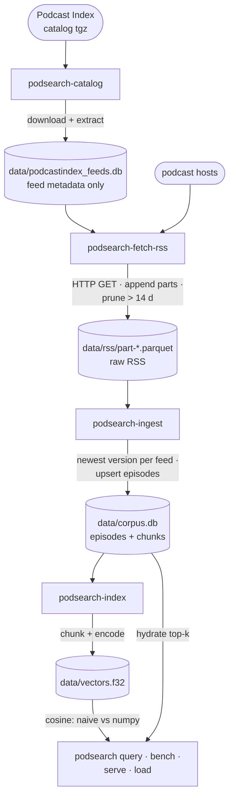

# podsearch — profiling demo

Semantic search over podcast episodes, built to be profiled. Two search implementations:

- `naive`: cosine similarity in a pure-Python loop (`index.search`) — the hot spot
- `numpy`: the same search as a single matrix product (`index.search_numpy`) — ~100x+ faster

Model: `model2vec` static embedding `minishlab/potion-base-8M` (256 dims, downloads ~30 MB
from Hugging Face on first use, cached afterwards). Corpus: podcast episodes selected from
the Podcast Index catalog and fetched via RSS. Index: `data/vectors.f32` (raw float32 matrix,
memory-mapped) + `data/corpus.db` (SQLite: episodes, chunks, ingest bookkeeping).

## Data pipeline

Four independent stages — each is its own script (and `python -m` module).
Inputs on the left, data stores (all gitignored under `data/`) in the middle,
consumers on the right:



```bash
# 1. download + extract the Podcast Index catalog (~1.8 GB tgz -> ~5 GB sqlite); skips if present
uv run podsearch-catalog

# 2. select feeds from the catalog and fetch their RSS into data/rss/*.parquet
#    idempotent: skips feeds already stored unless catalog lastUpdate is newer;
#    parts older than --prune-days (default 14) are deleted afterwards (0 disables)
uv run podsearch-fetch-rss                          # 10k most recently active en+de feeds
uv run podsearch-fetch-rss --feeds 100 --order episodes --lang en

# 3. parse stored RSS into the episodes corpus (incremental: only new parquet
#    parts; only the newest fetched version per feed is parsed, episodes upsert)
uv run podsearch-ingest                             # --max-per-feed 300 caps long feeds

# 4. embed episodes into chunks + vectors (full rebuild of derived data)
uv run podsearch-index
```

Storage layout (all under gitignored `data/`):

- `podcastindex_feeds.db` — feed catalog (4.7M feeds; metadata only, no episode content)
- `rss/part-*.parquet` — raw RSS bodies + `fetch_date` + all catalog columns per feed;
  append-only history, parts pruned after 14 days (pruned feeds get refetched)
- `corpus.db` — `episodes` (feed_url, guid, podcast, title, link, pubdate, text;
  upserts on refetch so it mirrors the latest stored feed version),
  `chunks` (vector_row, episode_id, text), `ingested_parts`, `meta`
- `vectors.f32` — raw float32 matrix aligned with `chunks.vector_row`

## Search

```bash
uv run podsearch query "startup fundraising advice"
uv run podsearch query "startup fundraising advice" --impl numpy

# benchmark: queries from podsearch/queries.txt
uv run podsearch bench --queries 2                 # naive: slow on purpose
uv run podsearch bench --impl numpy --queries 20 --repeat 100

# web service (attach target)
uv run podsearch-serve                                  # serves :8000

# load generator (run in a second terminal)
uv run podsearch-load --duration 30 --concurrency 4
uv run podsearch-load --url http://127.0.0.1:8000/search-async --duration 30
```

The `-m` form also works (`uv run python -m podsearch.cli bench`,
`uv run python -m podsearch.ingest`).

## Profiling with Tachyon (Python 3.15, `profiling.sampling`)

```bash
# run and profile a module — text table to stdout
uv run python -m profiling.sampling run -m podsearch.cli bench --queries 2

# flamegraph / heatmap / collapsed
uv run python -m profiling.sampling run --flamegraph -o results/flame.html  -m podsearch.cli bench --queries 2
uv run python -m profiling.sampling run --heatmap    -o results/heat       -m podsearch.cli bench --queries 2
uv run python -m profiling.sampling run --collapsed  -o results/stacks.txt -m podsearch.cli bench --queries 2

# faster rate, native frames, opcodes, modes
uv run python -m profiling.sampling run -r 10khz --flamegraph -o results/flame-10khz.html -m podsearch.cli bench --queries 2
uv run python -m profiling.sampling run --native --flamegraph -o results/flame-native.html -m podsearch.cli bench --queries 2
uv run python -m profiling.sampling run --opcodes --flamegraph -o results/flame-opcodes.html -m podsearch.cli bench --queries 2
uv run python -m profiling.sampling run --mode=cpu  -m podsearch.cli bench --queries 2
uv run python -m profiling.sampling run --mode=gil  -m podsearch.cli bench --queries 2
uv run python -m profiling.sampling run --mode=exception -m podsearch.cli bench --queries 2

# record binary, replay to another format
uv run python -m profiling.sampling run --binary -o results/naive.bin -m podsearch.cli bench --queries 2
uv run python -m profiling.sampling run --binary -o results/numpy.bin -m podsearch.cli bench --impl numpy --repeat 100
uv run python -m profiling.sampling replay --flamegraph -o results/numpy.html results/numpy.bin

# differential flamegraph: baseline first
uv run python -m profiling.sampling run --diff-flamegraph results/naive.bin -o results/diff.html -m podsearch.cli bench --impl numpy --repeat 100
```

## Attach to the running server

**Requires ptrace permission.** `run` works out of the box (the profiler is the parent).
`attach` to an already-running process is blocked by `ptrace_scope=1` until you run once:

```bash
echo 0 | sudo tee /proc/sys/kernel/yama/ptrace_scope   # reset to 1 when done
```

Then, with the server running and load applied:

```bash
PID=$(pgrep -f "podsearch-serve" | head -1)
uv run python -m profiling.sampling dump $PID                       # one stack snapshot
uv run python -m profiling.sampling attach --live $PID              # top-like TUI, q quits
uv run python -m profiling.sampling attach -d 20 --flamegraph -o results/attach.html $PID
uv run python -m profiling.sampling attach -d 20 --mode=wall $PID   # includes idle wait
uv run python -m profiling.sampling attach -d 20 --mode=cpu  $PID   # only on-CPU samples
uv run python -m profiling.sampling attach --async-aware -d 20 $PID # with load on /search-async
```

## Comparison

```bash
# deterministic profiler (formerly cProfile)
uv run python -m profiling.tracing -o results/trace.pstats -m podsearch.cli bench --queries 2
uv run python -m cProfile -s cumtime -m podsearch.cli bench --queries 2 | head -30

# py-spy (third-party; also attach-capable)
uvx py-spy record -o results/pyspy.svg -- uv run python -m podsearch.cli bench --queries 2
uvx py-spy top --pid $PID
```

## Development

```bash
task check      # lint + typecheck + test (ruff, ty, pytest)
task catalog    # download the feed catalog
task fetch      # fetch RSS into data/rss/
task ingest     # parse RSS into corpus.db
task index      # build vectors.f32
task bench      # = uv run podsearch bench
task serve      # = uv run podsearch-serve
task load       # = uv run podsearch-load
```

## Files

- `podsearch/core/paths.py` — data/ file locations
- `podsearch/core/catalog.py` — catalog download + feed selection SQL
- `podsearch/core/fetch.py` — idempotent RSS fetch -> parquet parts, `parse_feed`
- `podsearch/core/corpus.py` — `strip_html`, `chunk`, corpus.db schema, `ingest_parts`
- `podsearch/core/index.py` — `build_index`, `search` (naive), `search_numpy`, hit hydration
- `podsearch/ingest.py` — stage-3 entrypoint
- `podsearch/indexing.py` — stage-4 entrypoint
- `podsearch/api.py` — FastAPI `/search`, `/search-async` (blocks the event loop), `/health`
- `podsearch/cli.py` — `query` / `bench`
- `podsearch/load.py` — threaded load generator
- `podsearch/queries.txt` — 20 queries used by `bench` and `load.py`
- `tests/` — unit tests for corpus, fetch, and index helpers
