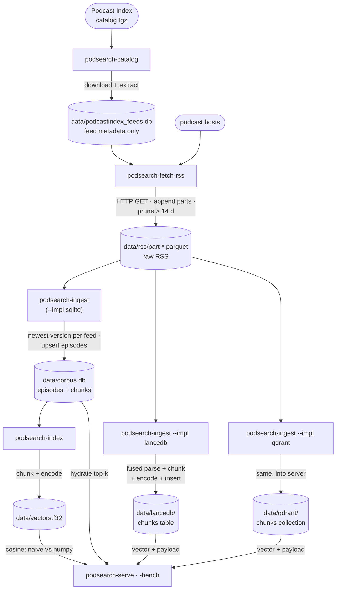

# podsearch

Semantic search over podcast episodes. Reference for developers who run the pipeline, serve search, or benchmark the four `--impl` backends.

**Jump to:** [Quick start](#quick-start) · [Pick a backend](#pick-a-backend) · [Command cheat sheet](#command-cheat-sheet) · [Pipeline](#pipeline) · [Search & serve](#search--serve) · [Profiling](#profiling) · [Orchestration](#orchestration-dagu) · [Storage](#storage-layout) · [Dev tasks](#development) · [Code map](#code-map)

---

## Quick start

Production path (`lancedb`, embedded, no server):

```bash
uv run podsearch-catalog                           # once: ~1.8 GB download, ~5 GB db
uv run podsearch-fetch-rss --feeds 500             # fetch RSS into data/rss/
uv run podsearch-ingest --impl lancedb             # parse + chunk + embed + insert
uv run podsearch-serve --impl lancedb              # UI + API on http://localhost:8000
```

Or run the whole thing as one DAG: `task pipeline-lancedb -- --params "FEEDS=500 LANG=en,de"`

Every stage is **idempotent**. Every search needs a **language** (`--lang` on the CLI, `lang` on the API).

---

## Pick a backend

| Implementation | Search function       | Data layout                           | Ingest commands (after catalog + fetch-rss)                     | Notes                                                                                            |
|----------------|-----------------------|---------------------------------------|-----------------------------------------------------------------|--------------------------------------------------------------------------------------------------|
| `naive`        | `index.search`        | `vectors.f32` + `corpus.db` hydration | `podsearch-ingest` → `podsearch-index` (sqlite pipeline)        | Pure-Python cosine loop. Slow on purpose; profiling target. **Default** for `serve` and `bench`. |
| `numpy`        | `index.search_numpy`  | same as `naive`                       | same as `naive`                                                 | Single matrix product, ~100x+ faster than `naive`.                                               |
| `lancedb`      | `lance_store.search`  | Embedded store: vector + metadata     | `podsearch-ingest --impl lancedb` (fused)                       | No hydration. **Production impl.** Returns cosine **distance**.                                  |
| `qdrant`       | `qdrant_store.search` | Server collection: vector + payload   | `task qdrant-up`, then `podsearch-ingest --impl qdrant` (fused) | Server-side HNSW. Returns cosine **similarity**.                                                 |

> **Scores differ by impl:** lancedb = cosine distance, qdrant = cosine similarity.

Note the naming: the ingest `--impl` for the `naive`/`numpy` path is `sqlite` (the default).

---

## Command cheat sheet

| I want to…                                 | Command                                                                   |
|--------------------------------------------|---------------------------------------------------------------------------|
| Download the feed catalog                  | `uv run podsearch-catalog`                                                |
| Fetch RSS (default 10k recent en+de feeds) | `uv run podsearch-fetch-rss`                                              |
| Fetch a small test set                     | `uv run podsearch-fetch-rss --feeds 100 --order episodes --lang en`       |
| Ingest, sqlite path                        | `uv run podsearch-ingest`                                                 |
| Build vectors, sqlite path                 | `uv run podsearch-index`                                                  |
| Ingest + index, lancedb                    | `uv run podsearch-ingest --impl lancedb` (`--rebuild` drops + recreates)  |
| Start Qdrant                               | `task qdrant-up` (stop: `task qdrant-down`)                               |
| Ingest + index, qdrant                     | `uv run podsearch-ingest --impl qdrant` (`--rebuild` drops + recreates)   |
| Serve API + UI on :8000                    | `task serve` or `uv run podsearch-serve [--impl lancedb] [--no-rerank]`   |
| Benchmark search                           | `uv run podsearch-bench --lang en --impl numpy --queries 20 --repeat 100` |
| HTTP load test                             | `task load` (needs running service on :8000)                              |
| Browse sample rows from all stores         | `task notebook`                                                           |
| Run a DAG once                             | `task pipeline`, `task pipeline-lancedb`, `task pipeline-qdrant`          |
| Dagu web UI + scheduler                    | `task dagu` (UI on :8081, no auth)                                        |
| Lint + typecheck + test                    | `task check`                                                              |

---

## Pipeline

Stages 1–2 run for every impl. Stages 3–4 depend on `--impl`: sqlite runs two commands, lancedb/qdrant run one fused command.



### Stage 1 — `podsearch-catalog` (all impls)

Download and extract the Podcast Index catalog. Skipped if the db exists.

|     |                                                                                            |
|-----|--------------------------------------------------------------------------------------------|
| In  | Catalog tgz from `--url` (~1.8 GB)                                                         |
| Out | `data/podcastindex_feeds.db` (`--db`): `podcasts` table, metadata only (~5 GB, 4.7M feeds) |

### Stage 2 — `podsearch-fetch-rss` (all impls)

Fetch RSS for selected feeds into parquet parts.

```bash
uv run podsearch-fetch-rss                          # 10k most recent en+de feeds
uv run podsearch-fetch-rss --feeds 100 --order episodes --lang en
```

| Flag              | Default  | Meaning                                |
|-------------------|----------|----------------------------------------|
| `--feeds`         | `10000`  | Max feeds to select                    |
| `--lang`          | `en,de`  | Languages; repeat or comma-separate    |
| `--min-episodes`  | `20`     | Min episodes per feed                  |
| `--updated-since` | `0`      | Newest episode at/after this unix time |
| `--order`         | `recent` | `recent`, `episodes`, `popularity`     |
| `--concurrency`   | `32`     | Parallel fetches                       |
| `--per-host`      | `4`      | Parallel fetches per host              |
| `--prune-days`    | `14`     | Delete older parts; `0` disables       |

- **In:** catalog db (`--db`), feed hosts over HTTP
- **Out:** `data/rss/part-*.parquet` (`--rss-dir`): RSS body, `fetch_date`, catalog columns
- **Skips** feeds already stored, unless catalog `lastUpdate` is newer
- **Retries** failed fetches on the next run

### Stages 3 + 4 — sqlite path (`--impl sqlite`, default; for `naive` / `numpy`)

#### `podsearch-ingest`

Parse RSS parts into the `episodes` table. Incremental; upserts on refetch.

```bash
uv run podsearch-ingest
```

| Flag             | Default | Meaning                 |
|------------------|---------|-------------------------|
| `--lang`         | `en,de` | Languages to ingest     |
| `--max-per-feed` | `300`   | Max episodes per feed   |
| `--parts`        | all     | Max new parts to ingest |
| `--parser`       | `rs`    | `rs` or `feedparser`    |

- **In:** `data/rss/part-*.parquet` (`--rss-dir`), newest version per feed only
- **Out:** `data/corpus.db` (`--db`): tables `episodes`, `ingested_parts`

#### `podsearch-index`

Chunk and embed all episodes. **Full rebuild** (not incremental).

```bash
uv run podsearch-index
```

- **In:** `corpus.db` (`--db`) table `episodes`; `--max-chunks-per-episode` (default `3`)
- **Out:** `data/vectors.f32` (`--vectors`, float32 matrix); `corpus.db` tables `chunks`, `meta` (`vector_row` = matrix row)

### Stages 3 + 4 — lancedb (`--impl lancedb`)

#### `podsearch-ingest --impl lancedb`

Parse, chunk, embed, and insert in one pass. Incremental.

```bash
uv run podsearch-ingest --impl lancedb
uv run podsearch-ingest --impl lancedb --rebuild    # drop + recreate store
```

Accepts the same flags as sqlite ingest, plus:

| Flag          | Default        | Meaning                         |
|---------------|----------------|---------------------------------|
| `--lance-dir` | `data/lancedb` | Store directory                 |
| `--rebuild`   | off            | Drop store, re-ingest all parts |

- **In:** `data/rss/part-*.parquet` (`--rss-dir`)
- **Out:** `data/lancedb/`: tables `chunks`, `ingested_parts`
- **`chunks` columns:** vector, feed_url, guid, podcast, episode, link, pubdate, text, language
- **ANN index** (HNSW-SQ): built once the table is large enough

### Stages 3 + 4 — qdrant (`--impl qdrant`)

#### `task qdrant-up`

Start Qdrant via docker compose (`compose.yaml`, `qdrant/qdrant` image). Stop with `task qdrant-down`.

- **Out:** server on `127.0.0.1:6333` (gRPC `6334`); storage in `data/qdrant/`

#### `podsearch-ingest --impl qdrant`

Parse, chunk, embed, and insert in one pass. Incremental. Requires a running Qdrant server.

```bash
uv run podsearch-ingest --impl qdrant
uv run podsearch-ingest --impl qdrant --rebuild     # drop + recreate collections
```

Accepts the same flags as sqlite ingest, plus:

| Flag           | Default                 | Meaning                                |
|----------------|-------------------------|----------------------------------------|
| `--qdrant-url` | `http://127.0.0.1:6333` | Server URL; env `PODSEARCH_QDRANT_URL` |
| `--rebuild`    | off                     | Drop collections, re-ingest all parts  |

- **In:** `data/rss/part-*.parquet` (`--rss-dir`), running Qdrant server
- **Out:** collections `chunks` (vector + same payload as lancedb) and `ingested_parts`

---

## Search & serve

### How search works

- **Language-scoped:** every search needs exactly one language ([ADR-0001](docs/decisions/0001-static-embeddings-language-scoped-search.md))
- **Two stages:** retrieve `max(6k, 30)` chunks → rerank → dedup to `k` episodes
- **Embedder:** `minishlab/potion-multilingual-128M` (model2vec, 256-dim, ~4k chunks/s)
- **Reranker:** `cross-encoder/mmarco-mMiniLMv2-L12-H384-v1` (~470 MB, **downloaded on first query**)
- **Torch:** installed from the `pytorch-cpu` uv index (PyPI has no cp315 Linux wheels)

What each impl reads at query time:

| `--impl`         | Reads                                |
|------------------|--------------------------------------|
| `naive`, `numpy` | `data/vectors.f32`, `data/corpus.db` |
| `lancedb`        | `data/lancedb/`                      |
| `qdrant`         | Qdrant server                        |

### `podsearch-serve`

Serves the FastAPI app and web UI on `:8000`.

```bash
task serve                                  # = uv run podsearch-serve
uv run podsearch-serve --impl lancedb
```

- `--impl` default: `naive`
- `--no-rerank`: skip the cross-encoder

| Endpoint                           | Params                                    |
|------------------------------------|-------------------------------------------|
| `GET /search`, `GET /search-async` | `q`, `lang` (required), `k` (default `5`) |
| `GET /api/stats`                   | none                                      |
| `GET /health`                      | none                                      |
| `GET /`                            | none (web UI)                             |

- **Out:** JSON hits (episode metadata, chunk text, sigmoid score); web UI at `http://localhost:8000`

### `podsearch-bench`

Times searches over `podsearch/queries.txt` (first `--queries` lines).

```bash
uv run podsearch-bench --lang en --queries 2                # naive: slow on purpose
uv run podsearch-bench --lang en --impl numpy --queries 20 --repeat 100
uv run podsearch-bench --lang en --impl lancedb --queries 20
uv run podsearch-bench --lang en --impl qdrant --queries 20
```

| Flag                       | Default                 | Meaning                      |
|----------------------------|-------------------------|------------------------------|
| `--lang`                   | required                | Language to search           |
| `--impl`                   | `naive`                 | Search backend               |
| `--queries`                | `5`                     | Queries to run               |
| `--repeat`                 | `1`                     | Repetitions of the query set |
| `-k`                       | `5`                     | Hits per query               |
| `--rerank` / `--no-rerank` | on                      | Cross-encoder rerank         |
| `--lance-dir`              | `data/lancedb`          | lancedb store                |
| `--qdrant-url`             | `http://127.0.0.1:6333` | qdrant server                |

- **Out (stdout):** `N queries in S s (X s/query)`
- `python -m` also works: `uv run python -m podsearch.cli.bench`

### `task load`

HTTP load against the running service (port 8000) using [oha](https://github.com/hatoo/oha).

```bash
task load
task load CONNECTIONS=2 -- -z 60s
```

- **In:** `podsearch/targets.txt` (override with `TARGETS=`), `CONNECTIONS=` (default `1`)
- **Out:** oha report: latency and requests/s

### Exploring the data

Sample random rows from every store under `data/` in a marimo notebook (one sample per store).

```bash
uv run marimo edit notebooks/sample.py    # or: task notebook
```

Use `marimo run` instead of `edit` for read-only.

---

## Profiling

Profile any command with Python 3.15 `profiling.sampling`.

- **Target:** a command via `-m module` or script path (no `PATH` lookup), or a PID for `attach`
- **Output formats:** `--flamegraph` / `--heatmap` → HTML; `--collapsed` → folded stacks; `--binary` → `.bin` (render with `replay`); no `-o` → live stats

| Flag                              | Meaning              |
|-----------------------------------|----------------------|
| `-d SECONDS`                      | Stop after N seconds |
| `--db data/corpus-prof.db`        | Scratch ingest db    |
| `--rss-dir data/rss-prof`         | Scratch fetch dir    |
| `--vectors data/vectors-prof.f32` | Scratch index file   |

Use scratch paths to force real work without touching real stores.

### Profile a pipeline stage

```bash
# ingest: feedparser is CPU-bound — the classic flamegraph target
uv run python -m profiling.sampling run -m podsearch.cli.ingest --db data/corpus-prof.db
uv run python -m profiling.sampling run --flamegraph -o results/ingest.html -m podsearch.cli.ingest --db data/corpus-prof.db
uv run python -m profiling.sampling run --heatmap    -o results/ingest-heat -m podsearch.cli.ingest --db data/corpus-prof.db
uv run python -m profiling.sampling run --collapsed  -o results/ingest.txt  -m podsearch.cli.ingest --db data/corpus-prof.db
uv run python -m profiling.sampling run -r 10khz --flamegraph -o results/ingest-10khz.html -m podsearch.cli.ingest --db data/corpus-prof.db
uv run python -m profiling.sampling run --opcodes --flamegraph -o results/ingest-opcodes.html -m podsearch.cli.ingest --db data/corpus-prof.db
uv run python -m profiling.sampling run --mode=cpu       -m podsearch.cli.ingest --db data/corpus-prof.db
uv run python -m profiling.sampling run --mode=exception -m podsearch.cli.ingest --db data/corpus-prof.db

# fetch-rss: 32 threads waiting on the network — wall vs cpu diverge,
# gil shows the threads aren't GIL-bound
uv run python -m profiling.sampling run --mode=wall -m podsearch.cli.fetch_rss --rss-dir data/rss-prof --feeds 500
uv run python -m profiling.sampling run --mode=cpu  -m podsearch.cli.fetch_rss --rss-dir data/rss-prof --feeds 500
uv run python -m profiling.sampling run --mode=gil  -m podsearch.cli.fetch_rss --rss-dir data/rss-prof --feeds 500

# index: model2vec encode — native frames under the Python stack
uv run python -m profiling.sampling run --native --flamegraph -o results/index-native.html -m podsearch.cli.indexing --vectors data/vectors-prof.f32
uv run python -m profiling.sampling run --native --heatmap -o results/index-heat -m podsearch.cli.indexing --vectors data/vectors-prof.f32

# record binary, replay to another format
uv run python -m profiling.sampling run --binary -o results/ingest.bin -m podsearch.cli.ingest --db data/corpus-prof.db
uv run python -m profiling.sampling replay --flamegraph -o results/ingest-replay.html results/ingest.bin
```

### Profile search

```bash
uv run python -m profiling.sampling run --binary -o local/search.bin -m podsearch.cli.bench --lang de --impl qdrant --queries 5
uv run python -m profiling.sampling replay --flamegraph -o local/search-replay.html local/search.bin
uv run python -m profiling.sampling replay --heatmap -o local/search-heatmap.html local/search.bin
```

### Attach to a running server

`attach` needs `ptrace_scope=0` (`run` works out of the box — the profiler is the parent):

```bash
echo 0 | sudo tee /proc/sys/kernel/yama/ptrace_scope   # reset to 1 when done
```

Then, with the server running and load applied:

```bash
PID=$(pgrep -f "podsearch-serve" | head -1)
uv run python -m profiling.sampling dump $PID                       # one stack snapshot
uv run python -m profiling.sampling attach --live $PID              # top-like TUI, q quits
uv run python -m profiling.sampling attach -d 20 --flamegraph -o results/attach.html $PID
uv run python -m profiling.sampling attach -d 20 --mode=wall $PID   # includes idle wait
uv run python -m profiling.sampling attach -d 20 --mode=cpu  $PID   # only on-CPU samples
uv run python -m profiling.sampling attach --async-aware -d 20 $PID # with load on /search-async
```

### Compare with other profilers

```bash
# deterministic profiler (formerly cProfile)
uv run python -m profiling.tracing -o results/trace.pstats -m podsearch.cli.ingest --db data/corpus-prof.db
uv run python -m cProfile -s cumtime -m podsearch.cli.ingest --db data/corpus-prof.db | head -30

# py-spy (third-party; also attach-capable)
uvx py-spy record -o results/pyspy.svg -- uv run python -m podsearch.cli.ingest --db data/corpus-prof.db
uvx py-spy top --pid $PID
```

---

## Orchestration (Dagu)

DAGs live in `orchestration/`. Install Dagu with `mise install`.

| DAG                                 | Impl    | Steps                                          |
|-------------------------------------|---------|------------------------------------------------|
| `podsearch.yaml`                    | sqlite  | catalog → fetch_rss → ingest → index           |
| `podsearch-lancedb.yaml`            | lancedb | catalog → fetch_rss → ingest_lancedb           |
| `podsearch-lancedb-index-only.yaml` | lancedb | ingest_lancedb `--rebuild` from existing parts |
| `podsearch-qdrant.yaml`             | qdrant  | catalog → fetch_rss → ingest_qdrant            |

| Task                                                             | What it does                                                                                      |
|------------------------------------------------------------------|---------------------------------------------------------------------------------------------------|
| `task dagu`                                                      | Web UI on `:8081` (no auth) + scheduler; reads `orchestration/*.yaml`; run history in `data/dagu` |
| `task pipeline`, `task pipeline-lancedb`, `task pipeline-qdrant` | Run one DAG once; record kept in Dagu. `pipeline-qdrant` needs `task qdrant-up`.                  |

```bash
task pipeline -- --params "FEEDS=500 LANG=en,de"
```

DAG params: `FEEDS`, `LANG`.

---

## Storage layout

Everything lives under gitignored `data/`:

| Store                   | Contents                                                                                                        |
|-------------------------|-----------------------------------------------------------------------------------------------------------------|
| `podcastindex_feeds.db` | Feed catalog (4.7M feeds; metadata only, no episode content)                                                    |
| `rss/part-*.parquet`    | Raw RSS bodies + `fetch_date` + catalog cols; append-only, pruned after 14 d                                    |
| `corpus.db`             | `episodes` (upserted, mirrors latest feed version), `chunks` (`vector_row` alignment), `ingested_parts`, `meta` |
| `vectors.f32`           | Float32 matrix, memory-mapped, aligned with `chunks.vector_row`                                                 |
| `lancedb/`              | `chunks` table (vector + metadata cols) + `ingested_parts`; HNSW-SQ ANN                                         |
| `qdrant/`               | Qdrant server volume: `chunks` + `ingested_parts` collections                                                   |

---

## Development

| Task                                          | Effect                                                    |
|-----------------------------------------------|-----------------------------------------------------------|
| `task check`                                  | lint + typecheck + test (ruff, ty, pytest)                |
| `task lint`                                   | `ruff check --fix` + `ruff format`                        |
| `task typecheck`                              | `ty check`                                                |
| `task test`                                   | `pytest --cov`                                            |
| `task catalog` / `fetch` / `ingest` / `index` | Pipeline stages = `podsearch-*` commands                  |
| `task bench` / `serve` / `load`               | = `podsearch-bench --lang en` / `podsearch-serve` / oha   |
| `task notebook`                               | `marimo edit notebooks/sample.py`                         |
| `task pipeline[-lancedb\|-qdrant]` / `dagu`   | Dagu runs / UI :8081                                      |
| `task qdrant-up` / `qdrant-down`              | Start/stop Qdrant container                               |
| `task update-dependencies`                    | `uv lock --upgrade` + sync + `prek update` + `task check` |

---

## Code map

| Path                              | Purpose                                                                                                           |
|-----------------------------------|-------------------------------------------------------------------------------------------------------------------|
| `podsearch/core/paths.py`         | `data/` file locations                                                                                            |
| `podsearch/core/catalog.py`       | Catalog download + feed selection SQL                                                                             |
| `podsearch/core/fetch.py`         | Idempotent async RSS fetch; decodes every feed to UTF-8 at fetch time                                             |
| `podsearch/core/rss_store.py`     | Parquet schema, streaming `PartWriter`, `already_fetched`, `prune_parts`                                          |
| `podsearch/core/parse.py`         | `parse_feed`, `lang_code` (RSS body → episode dicts)                                                              |
| `podsearch/core/corpus.py`        | `strip_html`, `chunk`, corpus.db schema, `ingest_parts`                                                           |
| `podsearch/core/index.py`         | `build_index`, `search` (naive), `search_numpy`, `rerank`, hit hydration                                          |
| `podsearch/core/lance_store.py`   | Fused ingest + index and `search` (`--impl lancedb`)                                                              |
| `podsearch/core/qdrant_store.py`  | Fused ingest + index and `search` (`--impl qdrant`)                                                               |
| `podsearch/core/ingest_common.py` | Chunk/encode helpers shared by fused stores                                                                       |
| `podsearch/api.py`                | FastAPI `/search`, `/search-async`, `/health`                                                                     |
| `podsearch/cli/`                  | One entrypoint per `podsearch-*` script: `catalog`, `fetch_rss`, `ingest`, `indexing`, `serve`, `bench`, `common` |
| `podsearch/queries.txt`           | 20 queries for `bench`                                                                                            |
| `podsearch/targets.txt`           | oha URL list for `task load` (German podcasts)                                                                    |
| `tests/`                          | Unit tests for corpus, fetch, index helpers                                                                       |
